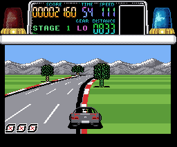

# Chase H.Q. for MSX + V9990

**Chase criminals through five stages in an MSX port of *Chase H.Q.* with Yamaha V9990 graphics and PSG sound.**

An unofficial homage port by **DiHalt Studio**, 2026.



## Play it

Download `chasehq_v9990.rom` or the complete ZIP from [Releases](../../releases). The game is a 1 MiB ASCII16 MegaROM for an MSX with 64 KB RAM and a V9990 cartridge. The picture comes from the V9990 output; sound comes from the MSX.

```sh
make run          # play the release ROM with openMSX and GFX9000
make run-turbor   # turbo R configuration
```

Read the player manual: [English](docs/manual/manual-en.pdf) · [Español](docs/manual/manual-es.pdf).

| Control | Keyboard | Joystick |
|---|---|---|
| Steer | Left / Right | Left / Right |
| Accelerate | Up | Up |
| Brake | Down | Down |
| Change gear, start, skip briefing | Space | Button 1 |
| Turbo | M | Button 2 |
| Pause | P | — |
| Quit | Q | — |

Nancy briefs you before each stage. Find the criminal's car, then ram it repeatedly before the time runs out. Avoid traffic and roadside hazards to keep your speed.

## About the port

The original MSX game supplies the driving logic. This port adds a V9990 display engine, editable graphics, a new title screen, PSG music and effects, and an ending. Nancy's briefing carries a repeating Morse SOS; ramming the criminal's car has its own longer crash effect.

The editable images and sound tracks live in `V9990-B1BP6/assets/editable/`. The program and display engine are in `V9990-B1BP6/src/`. See [the design notes](docs/DESIGN.md) and [asset guide](V9990-B1BP6/assets/README.md).

## Building from source

Building needs both sides of the original MSX cassette in CAS format. Put them at `original/side-a.cas` and `original/side-b.cas` (or set `SIDE_A=path` and `SIDE_B=path`). The cassette is supplied separately and stays outside Git. `make` extracts the cassette, reconstructs the original game image locally, and assembles the V9990 port. See [docs/BUILDING.md](docs/BUILDING.md). You also need classic SjAsm 0.42c, Python 3 with Pillow, and `zip`; rebuilding the manuals needs LaTeX.

```sh
make             # build V9990-B1BP6/build/chasehq_v9990.rom
make release     # collect ROM, both manuals and a ZIP under release/
make manual      # rebuild the English and Spanish PDFs
make help
```

The repository contains the port ASM sources, cassette extraction and reconstruction tools, editable assets, design notes, screenshots and both PDF manuals. `release/` holds the downloadable files and is ignored by Git.

## Make it better

Repaint a sprite sheet or HUD panel, tune the 64-colour palette, replace a VGM sound track, or improve the V9990 renderer. The sources are documented for anyone who wants to learn from them. **Please improve the game if you feel so!**

## Credits and rights

* *Chase H.Q.* was published for MSX by Ocean in 1989. Its name, original game, graphics and music belong to their respective rights holders.
* V9990 port, display engine, editable art pipeline, sound adaptation, title screen and manual: DiHalt Studio, 2026.
* This is an unofficial port for study, preservation and homage. It is not affiliated with the original publisher.
* MSX is a trademark of MSX Licensing Corporation. The V9990 chip photo in the manual is by Yaca2671 ([Wikimedia Commons](https://commons.wikimedia.org/wiki/File:V9990_01.jpg), CC BY-SA 3.0).
* Built with [SjAsm](http://www.xl2s.tk/), [openMSX](https://openmsx.org/) and [Tiled](https://www.mapeditor.org/).
